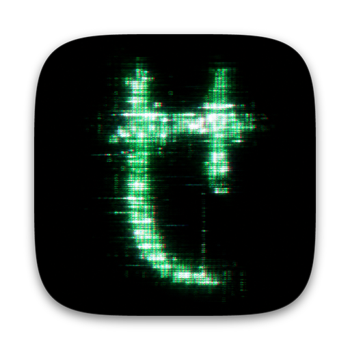

<p align="center">
  
</p>

<h1 align="center">Dreams</h1>

<p align="center"><em>Wake up, Neo...</em></p>

I want to get on with my own things while agents work, not run from window to window and screen to screen to see what they are doing. And I would rather not let everyone around see what is happening on my screen: the terminals, the code, the diffs. So this app appeared.

Dreams covers your screen with Matrix digital rain and ties it to your coding agents, Codex and Claude Code. Every agent message floods the screen with rain, every tool call runs down it as a line (`bash: brew install fontforge`), and between messages the rain settles into a calm background. One glance tells you the agents are alive and busy; the windows themselves stay out of sight, and to anyone else it is just an animation.

- **The rain follows your agents.** A message, a tool call or the end of a turn makes it surge, then it fades back to calm.
- **Call lines run in the rain.** The tool and its main argument, with secret-looking values replaced by `***`.
- **It hides what is on screen.** On black, the rain covers the whole screen, so what you are working on is not on show. In the transparent mode it falls over your windows instead; either way, by default it stays out of your screenshots and recordings, so the windows underneath can still be captured.
- **The real glyphs.** A font restored glyph by glyph from the film, plus a calligraphic Latin and Cyrillic set drawn in the same hand, so words and commands look right.
- **Yours to tune.** Color, density, speed, glow, calm level, word color; reset to defaults in one click.

Free, MIT-licensed, macOS 15 or newer. Developed on Apple silicon; the build is universal.

## Install

With [Homebrew](https://brew.sh):

```sh
brew install --cask SoundBlaster/tap/dreams
```

Or download the notarized `Dreams-<version>.dmg` from the [latest release](https://github.com/SoundBlaster/Dreams/releases/latest), open it and drag `Dreams.app` to `/Applications`.

Or build it yourself: `make app` (Swift 6.2+), then `open dist/Dreams.app`.

## Quick start

1. Open Dreams. Its window appears and a glyph icon sits in the menu bar.
2. In **Agent hooks**, press **Connect** for Codex and for Claude Code. Codex asks you to review the new hooks in `/hooks`; Claude Code reads them in a new session.
3. Press **Start Matrix**. The rain runs for five minutes (⌃⌥⌘D stops it from anywhere, `Esc` while Dreams is active).
4. Start an agent. Each message makes the rain surge; tool calls fall as lines.

The same from a terminal: `/Applications/Dreams.app/Contents/MacOS/Dreams --install-hooks`. Nothing leaves your Mac: the hooks only write short labels to a local mailbox.

## What it shows

| Moment | In the rain |
| --- | --- |
| You send a prompt | a `TASK` line, and the screen floods |
| An agent calls a tool | a line such as `read: Sources/Dreams/MatrixRain.swift` or `bash: brew install fontforge` |
| Messages keep coming | the rain stays dense |
| The agent pauses | it decays to the calm background you set |
| A turn ends | a short word (`done`) and the rain settles |

Words and lines are drawn in the film's own letterforms, vertically, one glyph per row.

## Settings

Everything in the window applies at once and is remembered. **Reset to Defaults** brings back the default look.

- **Rain**: color, density, speed, fade, brightness spread, glow.
- **Between agent messages**: how calm the background is; transparent background; hide the rain from screenshots and recordings.
- **Agent words**: color and brightness.
- **Agent hooks**: connect or disconnect Codex and Claude Code.
- **Glyphs**: the restored film glyphs or the classic Matrix Code font.

The app is in English and Russian and follows the system language.

## For agents: MCP

Dreams is also an MCP server, so an agent can start and stop the rain, hide it before it takes screenshots, and publish short public labels:

```toml
[mcp_servers.dreams]
command = "/Applications/Dreams.app/Contents/MacOS/Dreams"
args = ["--mcp"]
```

Tools: `dreams_status`, `dreams_preview`, `dreams_start`, `dreams_stop`, `dreams_prepare_ui`, `dreams_resume`, `dreams_publish_keywords`, `dreams_clear_keywords`, and the experimental `dreams_workspace_create` / `dreams_workspace_close`. Details are in the [reference](docs/REFERENCE.md#mcp).

## Privacy

- Dreams does not capture your screen, use the camera or microphone, or send anything over the network.
- A hook stores a short label and, for tool calls, the tool name and its main argument (up to 60 characters). Prompt text, tool output and transcripts are not stored. The mailbox lives in `~/Library/Application Support/Dreams` with owner-only permissions.
- Secret redaction (`TOKEN=…`, `Authorization: Bearer …`, `--password …`, `user:pass@`, long opaque strings) is pattern-based and is not a guarantee. The rain is a screen effect, not a security feature: anyone close enough to read the lines can read them. It keeps a transcript off the screen; it does not protect secrets.
- The optional virtual display for UI agents uses a private macOS API and is experimental.

## Uninstall

```sh
scripts/uninstall.sh --purge --dry-run   # list what would be removed
scripts/uninstall.sh --purge             # quit Dreams, remove hooks, the app, settings and the mailbox
```

Your other hooks and settings in `~/.codex` and `~/.claude` are left alone.

Installed with Homebrew: remove the hooks first (`/Applications/Dreams.app/Contents/MacOS/Dreams --uninstall-hooks`), then `brew uninstall --cask --zap dreams`.

## Documentation

- [Technical reference](docs/REFERENCE.md): how the rain works, every setting, hooks and MCP in detail, display notes, tests, releases.
- [Glyph pipeline](research/glyphs/PIPELINE.md): restoring the film glyphs and drawing the Latin and Cyrillic sets, byte-reproducible.
- [Glyph catalogue](research/glyphs/README.md): the 28 film glyphs, their identifications and evidence.

## Develop

`make help` lists everything: `make app`, `make run`, `make test`, `make glyphs`, `make icon`, `make release`.

## License and credits

MIT, see [LICENSE](LICENSE). Third-party licenses (Matrix Digital Rain font and repertoire, adapted Screener code, Chromium's virtual display code, the Swift packages) are in [THIRD_PARTY_NOTICES.md](THIRD_PARTY_NOTICES.md). The visual principle comes from [Rezmason/matrix](https://github.com/Rezmason/matrix). The Matrix and its imagery belong to their owners; this is an unofficial fan project.
