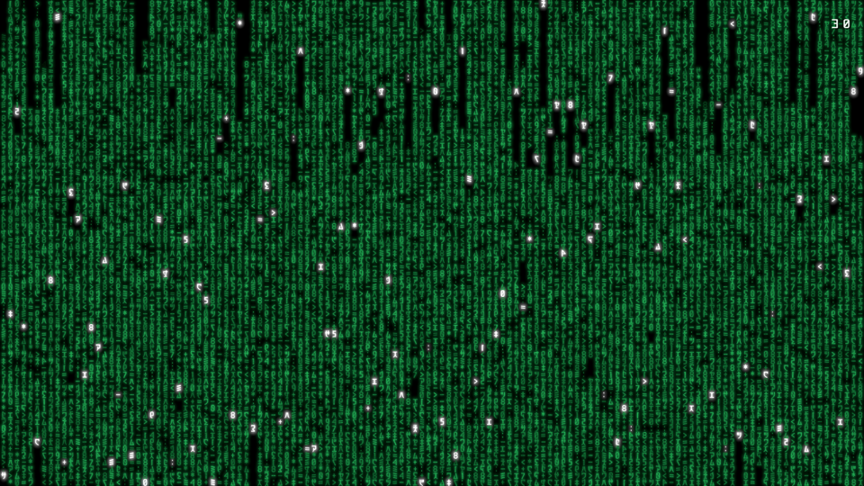

# FPS readout validation — 2026-10-24

Implementation source: `58bb3bd8628392fd9b26dd6d0127066a99cb2c24`; [byte identities](../../evidence/2026-10-24/source-identity.json).
Current source bindings were refreshed in affected packages; historical records remain unchanged.

## Local checks

- Final macOS Release suite: 91 reported tests / 22 suites passed; opt-in GPU/UI cases disabled in the default run.
- `DREAMS_TEST_METAL=1 swift test -c release --filter PresentedFPS`: 3 tests passed,
  including a real offscreen Metal render of Dreams digits in the upper-right bounds.
- Final tvOS Release Simulator: 17 tests passed, including default-off, persistence
  and reset assertions, with the final shared overlay helper. Test-only ENABLE_TESTABILITY=YES.
- `make lint`, localization and diff whitespace checks passed before final docs.
- Final `make specs-check` passed: HC parse/validation, macOS/TV FPS contexts, all
  SpecPM packages. Existing external-capability resolution warnings remain.
- Current full-file source binding audit: 229 bindings, no stale files.
- Commands, tool identity, source/map hashes and log hashes: [results](results.json).

The CPU tests use synthetic timestamps: 30/15 FPS, duplicate/invalid times,
reset and stale callbacks. The Metal test checks visible ink/location, not font
fidelity. TV GPU-completion FPS differs from macOS drawable presentation FPS.
No physical-device FPS accuracy, compositor parity or overhead acceptance is claimed.
Offline PNG rendering deliberately excludes a live counter.

## Simulator UI observation

Apple TV Simulator (tvOS 27), Release: Advanced toggle started off, Select
turned it on, Play/Pause closed the menu, digits remained visible at top right
in two captures. Turning it off removed the readout; the original off preference
was restored. No clipping or overlap was observed.

Xcode interaction metadata reported `NotRun` despite the live process, hierarchy
and successful interactions. The session was closed. UI captures precede the
final rebuild: the later optional top-inset parameter only changes macOS preview
placement; the TV draw path retains its default 32-pixel top inset. Source tests
and screenshots are separate evidence. Physical TV was not modified.
